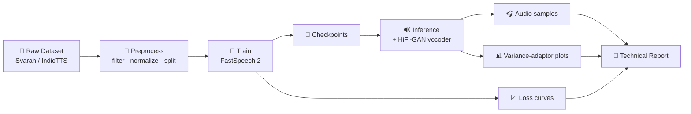

<div align="center">

# 🎙️ FastSpeech 2 TTS — English & Telugu

**A command-line text-to-speech pipeline for English (Svarah) and Telugu (IndicTTS), built on FastSpeech 2.**

[](https://arxiv.org/abs/2006.04558)
[](https://github.com/ming024/FastSpeech2)


[Overview](#-overview) •
[Pipeline](#-pipeline-at-a-glance) •
[Quick Start](#-quick-start) •
[Workflow](#-step-by-step-workflow) •
[Outputs](#-outputs) •
[Checklist](#-assignment-checklist) •
[FAQ](#-faq--troubleshooting)

</div>

---

## 📌 Overview

This project implements an end-to-end **FastSpeech 2** text-to-speech system for two languages, following the paper
[*FastSpeech 2: Fast and High-Quality End-to-End Text to Speech*](https://arxiv.org/abs/2006.04558) and the reference
implementation at [ming024/FastSpeech2](https://github.com/ming024/FastSpeech2).

| | English | Telugu |
|---|---|---|
| **Dataset** | Svarah | IndicTTS Telugu |
| **Preprocess** | `python English/preprocess.py` | `python Telugu/preprocess.py` |
| **Train** | `python English/train.py` | `python Telugu/train.py` |
| **Infer** | `python English/inference.py` | `python Telugu/inference.py` |
| **Results** | `Results/English/` | `Results/Telugu/` |

**What's included**

- 🔤 Separate, language-specific preprocessing, training, and inference scripts
- ⚙️ Per-language `config.yaml` files
- 💾 Checkpoint saving and resumable training
- 📈 Training/validation loss plots
- 🔊 Synthesized audio for the required test sentences
- 🎚️ Variance-adaptor plots for **duration**, **pitch (F0)**, and **energy**
- 📄 Automated technical report generation (PDF)

> [!NOTE]
> This is a **command-line project**. No dashboard or web UI is required — every step runs from the terminal.

---

## 🔁 Pipeline at a Glance



<details>
<summary><b>📁 Repository structure</b> (click to expand)</summary>

```text
project/
├── English/          preprocess.py · train.py · inference.py · config.yaml · checkpoints/
├── Telugu/           preprocess.py · train.py · inference.py · config.yaml · checkpoints/
├── fs2/              Shared FastSpeech 2 package (model, aligner, front-ends, pipeline)
│   ├── transformer/
│   ├── hifigan/
│   ├── model/
│   └── text/
├── Results/
│   ├── English/
│   └── Telugu/
├── Report/
├── scripts/          smoke_test.py · make_report.py
├── test_sentences/
├── docs/
├── README.md
├── requirements.txt
└── .gitignore
```

</details>

---

## 🚀 Quick Start

### 1. Create the environment

```bash
python -m venv .venv
```

<details open>
<summary><b>🪟 Windows (PowerShell)</b></summary>

```powershell
.\.venv\Scripts\Activate.ps1
```

</details>

<details>
<summary><b>🐧 Linux / 🍎 macOS</b></summary>

```bash
source .venv/bin/activate
```

</details>

### 2. Install dependencies

```bash
python -m pip install --upgrade pip
pip install -r requirements.txt
python -c "import nltk; [nltk.download(p) for p in ('averaged_perceptron_tagger_eng','averaged_perceptron_tagger','cmudict')]"
```

### 3. (Optional) Authenticate with Hugging Face

Required only if you load datasets from the Hugging Face Hub:

```bash
huggingface-cli login
```

### 4. Verify the installation ✅

Run the smoke test to confirm the full pipeline works end-to-end — without needing full dataset training:

```bash
python scripts/smoke_test.py
```

> [!TIP]
> Run the smoke test first. It's the fastest way to confirm that preprocessing, training, inference, and output
> generation all work in your environment before committing to a long training run.

---

## 🧭 Step-by-Step Workflow

### Step 1 — Preprocess the data

```bash
python English/preprocess.py
python Telugu/preprocess.py
```

<details>
<summary>What happens during preprocessing?</summary>

1. **Load** the dataset
2. **Filter** invalid or unsuitable utterances
3. **Normalize** text using language-specific rules
4. **Split** into train and validation sets — with **no overlap**
5. **Extract** robust acoustic features for training
6. **Write** processed data for model training

</details>

### Step 2 — Train the models

```bash
python English/train.py
python Telugu/train.py
```

Resume an interrupted run from the latest checkpoint:

```bash
python English/train.py --resume
python Telugu/train.py --resume
```

| Output | Location |
|---|---|
| Checkpoints | `English/checkpoints/`, `Telugu/checkpoints/` |
| Training & validation loss logs | Per-language folders |
| Loss plots | `Results/<Language>/` |

### Step 3 — Run inference & variance-adaptor analysis

```bash
python English/inference.py
python Telugu/inference.py
```

| Output | Location |
|---|---|
| 🔊 Synthesized speech | `Results/<Language>/test_generated_audios/` |
| 📊 Duration / pitch / energy plots | `Results/<Language>/variance_adaptor_plots/` |
| 🗂️ Per-sentence metadata | Generated alongside outputs for analysis |

### Step 4 — Generate the technical report

```bash
pip install playwright
playwright install chromium
python scripts/make_report.py
```

📄 Output: **`Report/Technical_Report.pdf`**

---

## 📦 Outputs

```text
Results/
├── English/
│   ├── training_loss.png
│   ├── validation_loss.png
│   ├── test_generated_audios/
│   └── variance_adaptor_plots/
│       ├── duration/
│       ├── pitch/
│       └── energy/
└── Telugu/
    ├── training_loss.png
    ├── validation_loss.png
    ├── test_generated_audios/
    └── variance_adaptor_plots/
        ├── duration/
        ├── pitch/
        └── energy/
```

---

## ✅ Assignment Checklist

Track your progress toward the full set of deliverables:

- [ ] Environment set up and `scripts/smoke_test.py` passes
- [ ] **English:** Svarah dataset preprocessed (train/val split, no overlap)
- [ ] **Telugu:** IndicTTS Telugu dataset preprocessed (train/val split, no overlap)
- [ ] **English:** FastSpeech 2 model trained, checkpoints saved
- [ ] **Telugu:** FastSpeech 2 model trained, checkpoints saved
- [ ] Training and validation loss plots generated for both languages
- [ ] Speech samples generated for all required test sentences
- [ ] Duration, pitch (F0), and energy plots generated for both languages
- [ ] `Report/Technical_Report.pdf` generated
- [ ] Trained checkpoints uploaded (or external links provided if GitHub size limits apply)

> [!IMPORTANT]
> Full completion requires training on the **real** Svarah and IndicTTS Telugu datasets. The smoke test only validates
> that the pipeline runs — it does not produce assignment-quality models.

---

## ❓ FAQ & Troubleshooting

<details>
<summary><b>Dataset download fails or returns an access error</b></summary>

If you're loading from the Hugging Face Hub, make sure you've run `huggingface-cli login` and that your account has
access to the dataset.

</details>

<details>
<summary><b>NLTK raises a "resource not found" error</b></summary>

Re-run the NLTK download command from the [Quick Start](#2-install-dependencies). The English front-end needs the
perceptron tagger and CMU Pronouncing Dictionary.

</details>

<details>
<summary><b>Training was interrupted</b></summary>

Pass `--resume` to the training script to continue from the latest saved checkpoint.

</details>

<details>
<summary><b>Report generation fails</b></summary>

`make_report.py` renders the PDF with a headless browser. Confirm that `playwright` is installed and that
`playwright install chromium` completed successfully.

</details>

<details>
<summary><b>Checkpoints are too large to push to GitHub</b></summary>

Host them externally (e.g., Google Drive or the Hugging Face Hub) and link them from this README.

</details>

---

## 🙏 Acknowledgements & References

This project builds on the following open-source work:

- **FastSpeech 2** — Ren et al., [*FastSpeech 2: Fast and High-Quality End-to-End Text to Speech*](https://arxiv.org/abs/2006.04558)
- **Reference implementation** — [ming024/FastSpeech2](https://github.com/ming024/FastSpeech2)
- **Vocoder** — HiFi-GAN reference implementation
- **Font** — Noto Sans Telugu (used in the technical report)

<div align="center">

<sub>Built as a command-line Python TTS pipeline · English 🇬🇧 · Telugu 🇮🇳</sub>

</div>
